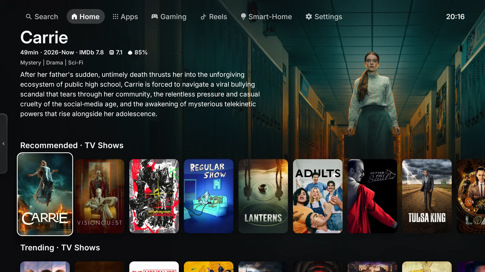
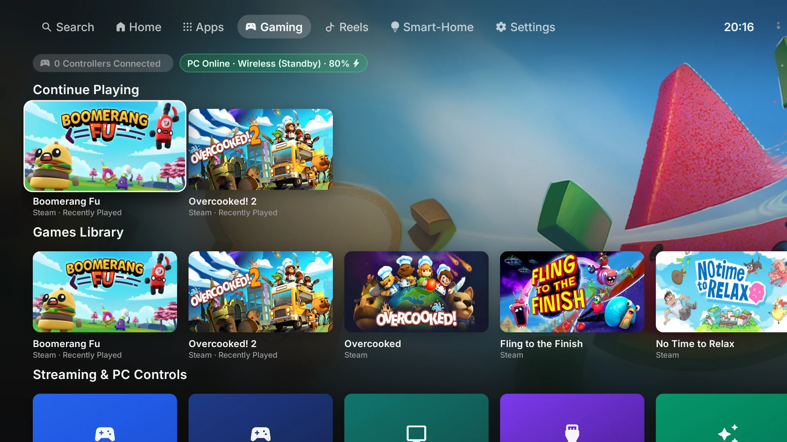
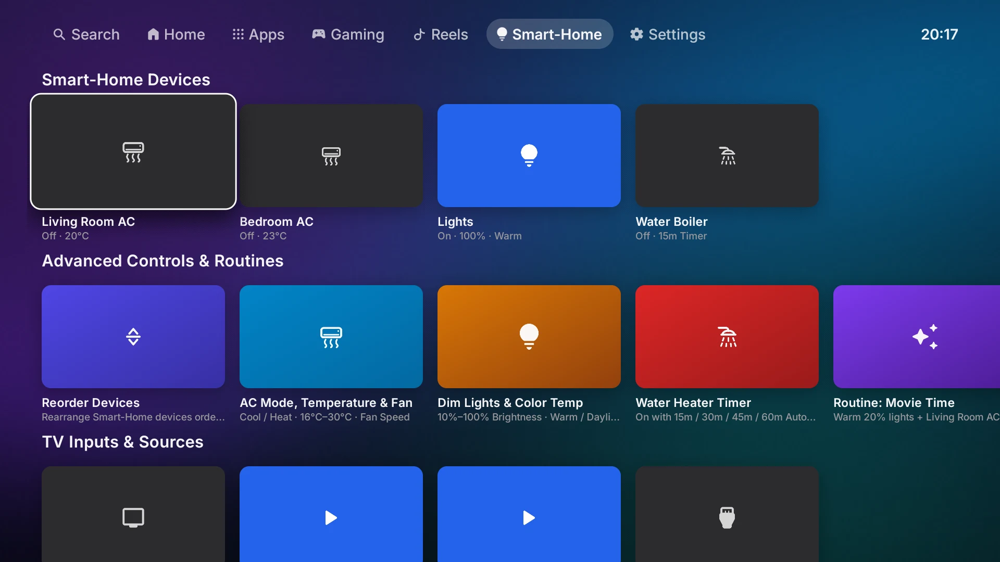
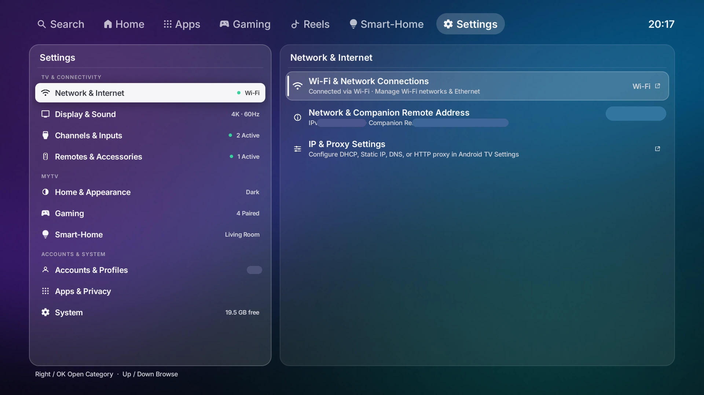
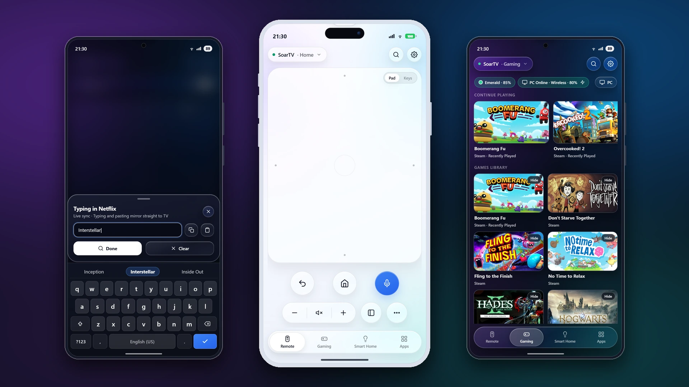

#  SoarTV

**A bloat-free 4K home screen built around you — not billboards.**

Modern smart TVs bury your favorite apps under rows of sponsored banners, auto-playing promos, and sluggish menus. **SoarTV** replaces that clutter with a fast, calm **4K Liquid Glass** interface designed around what *you* actually watch and do in your living room. Beyond organizing your streaming apps and watchlists in one place, SoarTV turns your phone into an instant Wi-Fi remote, links your Windows PC to your TV for low-latency high-res streaming, and puts your living-room **smart lights and climate controls** one click away — while automatically hiding optional tabs you don't need.

---

## Table of Contents

1. [Visual Tour](#visual-tour)
2. [Features at a Glance](#features-at-a-glance)
3. [Supported TVs & Platforms](#supported-tvs--platforms)
4. [How to Install (Human Guide)](#how-to-install-human-guide)
5. [Services & API Keys Reference](#services--api-keys-reference)
6. [Troubleshooting & Q&A](#troubleshooting--qa)
7. [For AI Setup Agents](#for-ai-setup-agents)
8. [Repository Structure](#repository-structure)

---

## Visual Tour

| Home & Personalized Discovery | Optional PC Gaming Zone |
| :---: | :---: |
|  |  |
| **Optional Living-Room Smart-Home Hub** | **Two-Panel Liquid Glass Settings** |
|  |  |
| **True-4K Fine Art & Nature Screensaver** | **Phone Companion Remote (iPhone & Android)** |
|  |  |

---

## Features at a Glance

- **User-First, Zero-Bloat 4K Interface**: Clean Top-Bar navigation (**Search**, **Home** with *TV Shows* & *Movies* sub-tabs, **Apps**, and **Settings**), an expandable favorite-apps Side-Shelf, 60fps animations, and automatic sunrise-to-sunset Light & Dark themes.
- **Always Works When Your Computer Is Off**: Every core TV feature — streaming discovery, AI search, smart-home controls, screensaver, and the phone remote — runs **100% natively inside the TV app** with zero dependency on a home PC.
- **Unified Watchlists, Critic Scores & AI Search**: Syncs two-way with **Trakt** and **Stremio**, displays **IMDb**, **Rotten Tomatoes**, and **Metacritic** ratings side-by-side, and lets you search by mood or plot description using **Google Gemini AI**.
- **Phone Companion Remote (`iPhone & Android`)**: Scan a QR code in SoarTV Settings to control your TV over local Wi-Fi in matching Liquid Glass Dark & Light themes — complete with an Apple-TV-style Clickpad & D-Pad, live two-way TV text-field sync (edit or copy what's typed on TV inside Netflix, YouTube, Stremio, or SoarTV), voice search, Smart-Home tiles, and temporary QR guest passes.
- **PC-to-TV Game Streaming *(Optional Tab)***: Streams your **Steam**, **Epic Games**, **Heroic**, and standalone Windows games straight inside SoarTV (resolution & frame rate adapt to your PC, TV, and network, or switches to HDMI automatically when plugged in), with Bluetooth/USB controller tagging and battery levels. *Don't game on your TV? SoarTV removes the Gaming tab automatically.*
- **Effortless Smart-Home Control *(Optional Tab)***: Dim **WiZ** smart lights, adjust **Sensibo** or **Tuya** air conditioners, set a **Switcher** boiler timer, or trigger *Movie Time* and *Good Night* routines from your couch. *Don't use smart-home appliances? SoarTV removes the Smart Home tab automatically.*
- **Easy Late Activation Anytime**: Skipped Gaming or Smart Home during setup? Turn either tab on later from **Settings -> Home & Appearance -> Interface & Units** or ask your AI agent to set it up whenever you're ready.
- **True-4K Ambient Screensaver**: Over **1,230 curated 4K UHD** fine-art paintings and nature/space photographs with 8 clock designs and live local weather.
- **Multi-User Household Profiles & Encrypted Vault**: Separate watchlists and history per family member, backed by hardware `AndroidKeyStore` encryption on your TV and optional zero-knowledge cloud backup.
- **Shared Short-Form Reels *(Work in Progress)***: Casting YouTube Shorts, TikTok, and Instagram Reels from your phone into a shared family TV queue is currently under active development (*WIP*) and disabled in public builds for now.

---

## Supported TVs & Platforms

- **Android TV & Google TV (`SoarTV.apk` — Full Feature Set)**: Xiaomi, TCL, Sony BRAVIA, Philips, Hisense, Toshiba, Skyworth / JVC, Chromecast with Google TV, Google TV Streamer, Walmart `onn.`, NVIDIA Shield, and AOSP projectors (Android 8 through Android 14+). Includes every feature: Launcher, Discovery, AI Search, Companion Remote, Smart-Home Hub, PC Game Streaming, Screensaver, and Multi-User Profiles.
- **Amazon Fire TV (`SoarTV.apk`)**: Fire TV sets and Fire TV Sticks (full Android TV app with dedicated HDMI switching; opens as an app while respecting Fire OS's Home button).
- **LG Smart TVs (`SoarTV-webos.ipk` — Lightweight Web Launcher)**: Runs on LG webOS 3.0 through webOS 24+ (ad-free app shelf, TMDB Movies/Shows discovery, HDMI & Live TV switching, local weather, sunrise/sunset themes, Magic Remote pointer, and screensaver). *Note: Phone Companion Remote, Smart-Home Hub, PC Game Streaming, AI Search, and Trakt/Stremio sync are native Android TV features — for the full suite on an LG or Samsung TV, plug in any Google TV / Android TV streamer.*
- **Samsung Smart TVs (`SoarTV-tizen.wgt` — Lightweight Web Launcher)**: Runs on Samsung Tizen 2.3 through Tizen 9+ (same lightweight web launcher feature set as LG webOS; requires signing with a free Samsung Tizen certificate via Tizen Studio or TizenBrew Installer).

---

## How to Install (Human Guide)

You don't need to manually download files, edit configuration files, or know how to build Android apps. Just paste **one single prompt** into your AI coding agent (**Claude Code**, **Google Antigravity**, **Cursor**, **Codex**, or **Windsurf**):

> Clone this SoarTV GitHub repository (`<paste this page's GitHub URL>`), read `AGENTS.md` and `docs/agents/install-playbook.md`, open the visual SoarTV Setup Studio (`python setup_wizard.py --wait-for-save`) so I can choose my options and free API keys comfortably, wait for me to click Save, and then install SoarTV on my TV.

### What Happens Next (Zero Guesswork)

1. **Your AI Agent Downloads SoarTV & Opens Setup Studio**: Your agent clones the repository and automatically opens **SoarTV Setup Studio** in your browser (styled just like the SoarTV TV app).
2. **Pick Your Preferences & Free Keys Visually**: Inside Setup Studio, choose your TV OS, city, optional **Smart-Home** and **PC Gaming** tabs (with a native folder picker for standalone game folders and custom Smart-Home brand support), and paste your free **TMDB** key (plus any optional keys — every key has a **`?`** icon with real screenshots showing exactly where to get it).
3. **Click `Save` — No Prompt Copying Needed**: When you click **Save & Continue Setup**, Setup Studio saves your keys privately on your computer (never uploaded anywhere), writes a local non-secret summary (`SoarTV-launcher/.setup_handoff.json`), closes automatically, and wakes your AI agent right back up.
4. **Safe TV Install & Full Reversibility**: You turn on *Developer Debugging* on your TV once (see [Troubleshooting & Q&A](#troubleshooting--qa) below) and press **Allow** on your TV screen. Installing SoarTV changes nothing on your TV until *you* open SoarTV Settings and switch Launcher Mode from **Original** to **SoarTV** — and switching back to **Original** restores your factory home screen anytime.

*(Prefer to open Setup Studio manually after cloning? Run `python setup_wizard.py`.)*

---

## Services & API Keys Reference

Every service supported by SoarTV offers a **free personal tier**. Click any group below to expand its table and signup links.

<details open>
<summary><strong>1. Movies, TV Shows, Watchlists &amp; Critic Ratings</strong> (1 Required · 4 Optional)</summary>

<br/>

| Service | What It Does in SoarTV | Requirement | Free-Tier Limit | Where to Get It | Config Property |
| :--- | :--- | :--- | :--- | :--- | :--- |
| **TMDB** | 4K backdrops, posters, 38+ genre rows & *"More Like This"* picks | **Required** *(for catalogs)* | Free (~50 req/sec) | [themoviedb.org/settings/api](https://www.themoviedb.org/settings/api) | `tmdb_key` |
| **Trakt** | Two-way Watchlist, watch progress, episode tracking & personal ratings | **Recommended** | Free personal account | [trakt.tv/oauth/applications/new](https://trakt.tv/oauth/applications/new) *(Redirect URI: `urn:ietf:wg:oauth:2.0:oob`)* | `trakt_client_id` + QR pair on TV |
| **Stremio** | Syncs your Stremio Library & mid-episode Continue Watching | **Recommended** | Free account | [stremio.com](https://www.stremio.com) | `stremio_email` + sign in on TV |
| **OMDb** | Adds **Rotten Tomatoes (RT)** & **Metacritic (MC)** scores | **Optional** | 1,000/day *(cached permanently)* | [omdbapi.com/apikey.aspx](https://www.omdbapi.com/apikey.aspx) *(click activation email)* | `omdb_key` |
| **MDBList** | Aggregates **Rotten Tomatoes** & **Metacritic** ratings | **Optional** | 1,000/day *(cached permanently)* | [mdblist.com/preferences](https://mdblist.com/preferences/) *(sign in directly, not via Trakt)* | `mdblist_key` |

</details>

<details>
<summary><strong>2. AI Voice &amp; Natural-Language Search</strong> (Optional)</summary>

<br/>

| Service | What It Does in SoarTV | Requirement | Free-Tier Limit | Where to Get It | Config Property |
| :--- | :--- | :--- | :--- | :--- | :--- |
| **Google Gemini AI** | Search movies & shows by mood, plot description, or natural voice queries | **Optional** | Free tier (`gemini-2.5-flash`) | [aistudio.google.com/app/apikey](https://aistudio.google.com/app/apikey) | `gemini_api_key` |

</details>

<details>
<summary><strong>3. Smart-Home Appliances — Lights, AC &amp; Boiler</strong> (Optional · Enables Smart Home Tab)</summary>

<br/>

*If you leave all Smart-Home settings empty (or set `enable_smarthome=false`), SoarTV automatically hides the Smart Home tab.*

| Service | What It Does in SoarTV | Requirement | Free-Tier Limit | Where to Get It | Config Property |
| :--- | :--- | :--- | :--- | :--- | :--- |
| **WiZ Smart Lights** | Local Wi-Fi bulb dimming (`10%–100%`), warm/daylight Kelvin & room control | **Optional** | 100% Free & Local (no key needed) | Auto-discovered over Wi-Fi UDP `38899` | `wiz_light_ips` *(or scan on TV)* |
| **Sensibo Sky** | Living-room smart AC power, mode, target temperature & fan speed | **Optional** | Free personal API | [home.sensibo.com/me/api](https://home.sensibo.com/me/api) | `sensibo_api_key` |
| **Tuya / Smart Life** | Smart AC power, temperature & mode control | **Optional** | Free IoT Trial / Personal project | [iot.tuya.com](https://iot.tuya.com) | `tuya_access_id`, `tuya_access_secret` |
| **Switcher** | Local smart water boiler toggle & auto-off countdown timer | **Optional** | Local LAN control | Switcher app device info | `switcher_device_ip`, `switcher_device_id` |

</details>

<details>
<summary><strong>4. PC-to-TV Game Streaming</strong> (Optional · Enables Gaming Tab)</summary>

<br/>

*If you don't configure a Gaming PC (or set `enable_gaming=false`), SoarTV automatically hides the Gaming tab.*

| Component | What It Does in SoarTV | Requirement | Cost | Where to Get It | Config / `.env` Property |
| :--- | :--- | :--- | :--- | :--- | :--- |
| **Sunshine Host** | Streams your Windows PC desktop & games to SoarTV's built-in player (resolution & frame rate depend on your hardware and network) | **Optional** | 100% Free & Open Source | [github.com/LizardByte/Sunshine/releases](https://github.com/LizardByte/Sunshine/releases) | Paired on TV via 6-digit code |
| **SoarTV Gaming Agent** | Auto-discovers Steam, Epic, Heroic & standalone PC games, switches HDMI/Wi-Fi & manages Sunshine power | **Optional** | Built into this repo (`tools/gaming/`) | Included in `SoarTV-launcher/tools/gaming/` | `SOARTV_GAMES_DIRS`, `SOARTV_NON_TV_MONITORS` |

</details>

<details>
<summary><strong>5. Multi-User Household Profiles &amp; Encrypted Cloud Vault</strong> (Optional)</summary>

<br/>

| Service | What It Does in SoarTV | Requirement | Free-Tier Limit | Where to Get It | Config Property |
| :--- | :--- | :--- | :--- | :--- | :--- |
| **Supabase** | Syncs family profiles, watchlists/history across devices & stores zero-knowledge `AES-256-GCM` key backups | **Optional** | Free (500 MB PostgreSQL) | [supabase.com/dashboard](https://supabase.com/dashboard) *(SQL schema in [`docs/supabase-schema.sql`](docs/supabase-schema.sql))* | `supabase_url`, `supabase_anon_key`, `household_key`, `admin_emails` |

</details>

---

## Troubleshooting & Q&A

<details open>
<summary><strong>What do I have to do manually vs. what does the AI agent do?</strong></summary>

<br/>

- **What you do yourself**:
  1. Turn on *Developer / Debugging mode* on your TV once (60 seconds — see below).
  2. Create your free **TMDB** key (and any optional keys you choose).
  3. Press **Allow** on your TV remote when the *"Allow USB/Wireless debugging?"* prompt appears on screen.
  4. *(Optional PC Gaming only)* Install Sunshine on your Windows PC and approve one Administrator setup step.
- **What your AI agent does automatically**: Checks or installs build tools, configures `config.properties` / `.env`, inspects your TV brand for safety, compiles and installs `SoarTV.apk` (with the Phone Remote bundled inside), pushes your keys into hardware encryption, and disconnects cleanly.

</details>

<details>
<summary><strong>How do I enable Wireless or Network Debugging on my TV?</strong></summary>

<br/>

- **Google TV & Android TV (Sony, TCL, Xiaomi, Philips, Hisense, Walmart `onn.`)**:
  Open **Settings -> System -> About**, highlight **Android TV OS Build**, and press **OK 7 times** until *Developer mode* unlocks. Go back to **Settings -> System -> Developer options** and turn ON **USB debugging** (and **Network debugging** if shown). Your TV's IP address is under **Settings -> Network & Internet -> your Wi-Fi network**.
- **Chromecast with Google TV & Android 14 Streamers**:
  Unlock **Developer options** as above, then open **Wireless debugging**, turn it ON, and select **Pair device with pairing code**. Give the 6-digit pairing code and IP:port on screen to your AI agent.
- **Amazon Fire TV**:
  Open **Settings -> My Fire TV -> About**, click your device name 7 times, then enable **ADB Debugging** under **Developer Options**.
- **LG webOS TVs**:
  Install **Developer Mode** from the LG Content Store, sign in with a free LG Developer account, turn **Dev Mode Status** ON (the TV restarts), and enable **Key Server**.
- **Samsung Tizen TVs**:
  Open the **Apps** screen, press `1 2 3 4 5` on your remote, switch **Developer mode** ON, enter your computer's IP address, and restart the TV.

</details>

<details>
<summary><strong>What if my AI agent fails to set an API key — how can I add keys myself?</strong></summary>

<br/>

You have three simple fallback options:
1. **Right on your TV screen**: Open **SoarTV -> Settings -> Get Started (Initial Setup & Cloud)** to pair Trakt with a QR code, sign in to Stremio, scan Wi-Fi for WiZ bulbs, and enter API keys directly.
2. **Using SoarTV Setup Studio on your computer**: Run `python setup_wizard.py`, enter your keys under **Media & Ratings** / **Optional Extras**, and click **Save & Continue Setup**.
3. **Editing `config.properties` directly**: Copy `SoarTV-launcher/config.example.properties` to `SoarTV-launcher/config.properties`, paste your key after `=`, and re-run the build.

</details>

<details>
<summary><strong>I hid the Gaming or Smart Home tab during setup. How do I add it later?</strong></summary>

<br/>

Both features remain built in and ready whenever you want them:
- **From your TV remote**: Go to **Settings -> Home & Appearance -> Interface & Units** and set **Gaming Tab Visibility** or **Smart Home Tab Visibility** to *Always Show* or *Automatic*.
- **With your AI agent**: Tell your agent *"Enable the Gaming tab (or Smart Home tab) in SoarTV and help me connect my PC / smart devices"* — the agent simply sets `enable_gaming=true` or `enable_smarthome=true` and syncs your new keys or PC folders.

</details>

<details>
<summary><strong>Google Play Protect showed "Risky app blocked" or "Built for an older version of Android"</strong></summary>

<br/>

Android 14 TVs display this one-time prompt when installing sideloaded apps that include a remote-button helper. On your TV remote, choose **More details -> Install anyway**. Always install over ADB (via your AI agent) rather than opening the APK inside a TV file-manager app.

</details>

<details>
<summary><strong>Why didn't my TCL TV switch home screens immediately?</strong></summary>

<br/>

Some TCL Google TV models block background jobs until **Auto-Start** is enabled for SoarTV in TCL's **Safety Guard** app (your AI agent also runs the matching `appops` permission command automatically during install). Once allowed, wait up to a minute and press the **Home** button.

</details>

<details>
<summary><strong>How do I return to my TV's original factory home screen?</strong></summary>

<br/>

SoarTV never deletes or modifies system apps. Open **SoarTV -> Settings -> System -> Launcher Mode** and choose **Original TV Home** — your factory launcher returns right away. Always switch back to **Original** before uninstalling SoarTV.

</details>

---

## For AI Setup Agents

If you are an AI coding assistant (like **Claude Code**, **Google Antigravity**, **Cursor**, **Codex**, **Windsurf**) helping a user install, customize, or adapt SoarTV, start here:

- **[`AGENTS.md`](AGENTS.md)** & **[`CLAUDE.md`](CLAUDE.md)** — Agent entry points, human-intake checklist, Smart TV safety protocol, and common local adjustments.
- **[`docs/agents/install-playbook.md`](docs/agents/install-playbook.md)** — Complete step-by-step build, install, secret-sync, LG/Samsung packaging, and PC gaming commands.
- **[`docs/agents/tv-brand-adaptation.md`](docs/agents/tv-brand-adaptation.md)** — Guide for inspecting unlisted TV models and extending remote/input adapters safely.
- **[`docs/supabase-schema.sql`](docs/supabase-schema.sql)** — Optional Dual-Path RLS PostgreSQL schema for Multi-User Profiles and Encrypted Cloud Backup.

---

## Repository Structure

```text
SoarTV/
├── setup_wizard.py             # Visual TV-styled Setup Studio (auto-launched by your AI agent)
├── setup_wizard.py                 # Cross-platform Python entry point for Setup Studio
├── assets/
│   ├── icons/                      # Official SoarTV app icons, 16:9 banner, trimmed transparent marks & bird SVG
│   └── screenshots/                # 4K TV & Phone Companion Remote preview images
├── docs/
│   ├── agents/                     # Step-by-step AI agent installation & TV-brand adaptation guides
│   └── supabase-schema.sql         # Optional Supabase Dual-Path RLS & Encrypted Vault SQL schema
├── SoarTV-launcher/                  # Native Android TV / Google TV / Fire OS Launcher (io.soartv)
│   ├── app/                        # Pure Java 4K Liquid Glass UI, Moonlight core, Smart Home & Secrets
│   ├── web/                        # Shared ES5 web launcher for LG webOS & Samsung Tizen TVs
│   ├── webos/ & tizen/             # Zero-SDK .ipk (LG) and .wgt (Samsung) packagers & installers
│   ├── tests/                      # Automated JUnit & web verification suites
│   ├── tools/
│   │   ├── gaming/                 # Optional Windows PC Gaming Agent (laptop_gaming_agent.py) & tests
│   │   ├── setup_gui/              # Liquid Glass Desktop Setup Studio server, UI & unit tests
│   │   ├── check.sh                # Full build, unit test, i18n & web compatibility runner
│   │   ├── send_key.py             # Hardware-encrypted AndroidKeyStore secret sync over ADB
│   │   └── translate.py            # 26-language localization validator
│   ├── config.example.properties   # Clean template for local build settings & optional tab flags
│   └── build.sh                    # Fast zero-Gradle APK builder (SoarTV.apk + bundled SoarTV-Remote.apk)
├── SoarTV-remote/                    # Phone Companion Remote PWA & Native Android App (io.soartv.remote)
├── .env.example                    # Environment variable template
├── AGENTS.md & CLAUDE.md           # Instructions & Smart TV safety rules for AI coding assistants
└── LICENSE                         # MIT License
```
